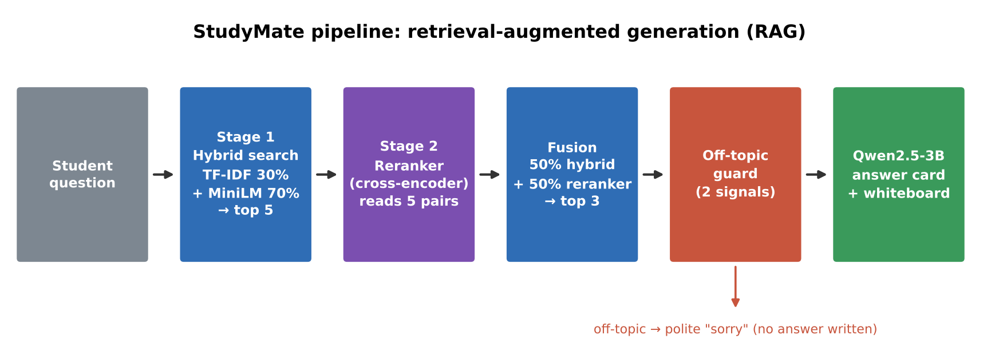
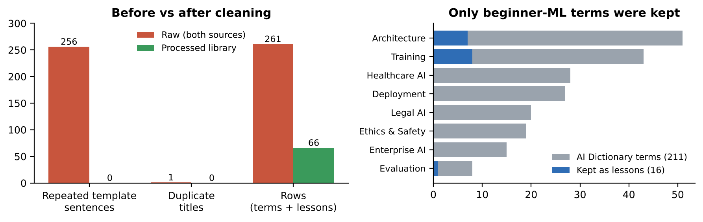
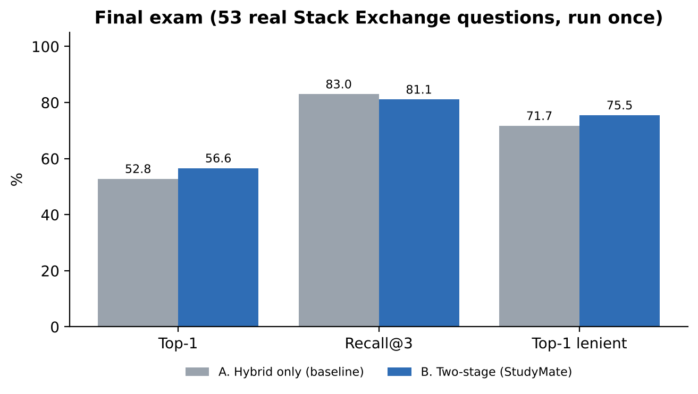
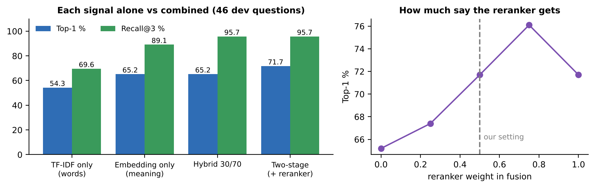
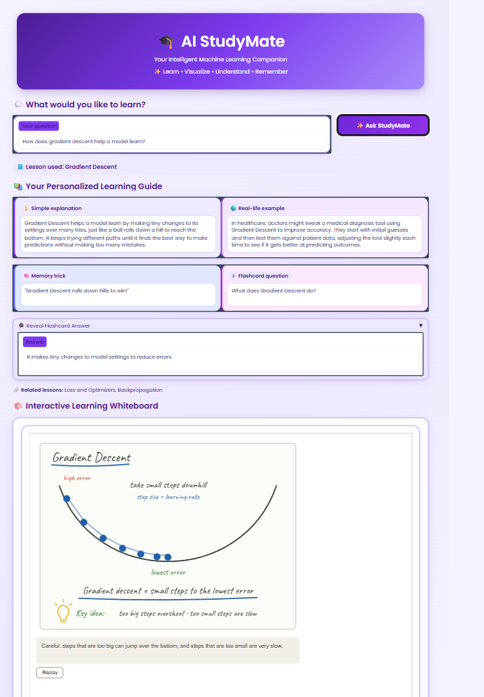
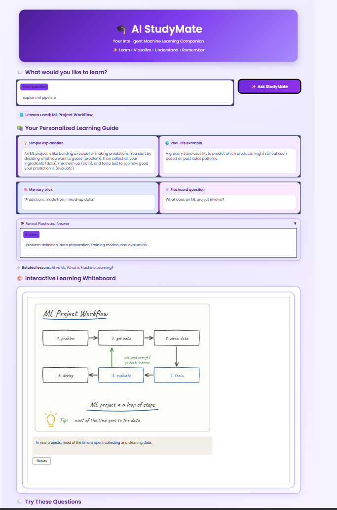
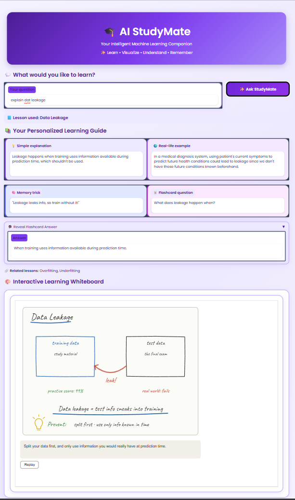
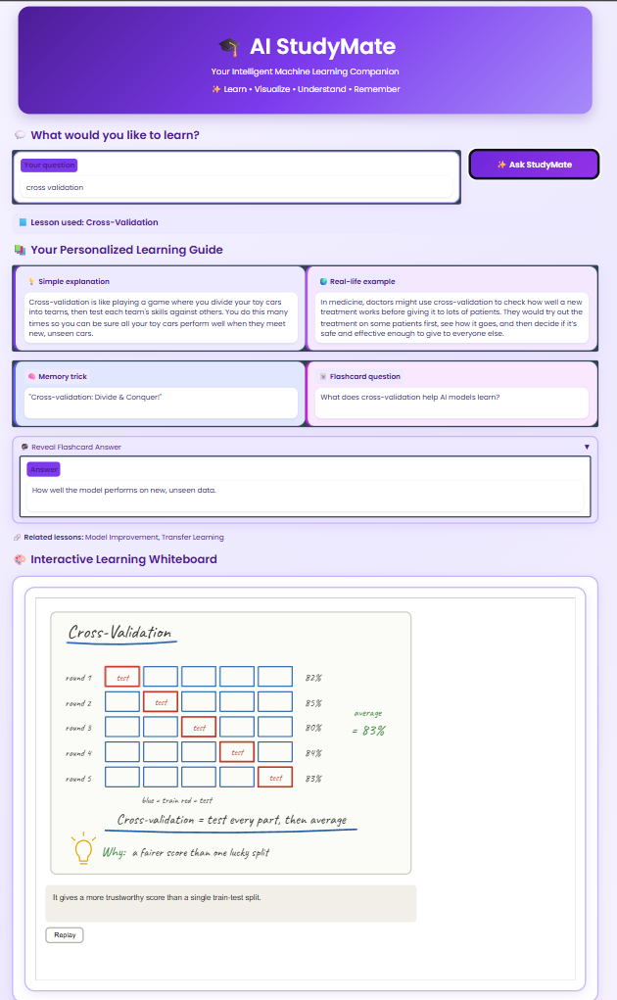
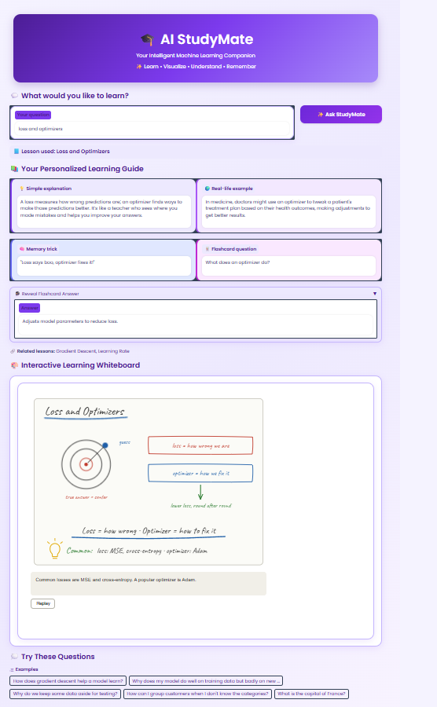

# 🎓 StudyMate – An AI Tutor That Explains Machine Learning to Beginners

*ITAI2377-Data-science-StudyMate-Final/: Implementing a Domain-Specific AI Assistant**
**Group 7:** Sadia Saeed · Eva Abouabouharb · Neida Guzman

StudyMate helps people with **no AI background** learn machine learning. A student types a question in plain words, and StudyMate:

1. finds the best lesson in its library of **66 ML lessons**,
2. writes a short **answer card**: a simple explanation, a real-life example, a memory trick, and a flashcard,
3. plays an animated, hand-drawn **whiteboard** for that lesson (all 66 lessons have one),
4. politely says **"sorry"** when a question has nothing to do with ML, instead of making up an answer.

Technically, StudyMate is a **retrieval-augmented generation (RAG)** system: it first *finds* the right lessons, and then *writes* the answer only from them.



---

## ✨ Features
| Part | What it does | Notebook cell |
|---|---|---|
| **Lesson library** | 50 core ML lessons written by our team + 16 terms from the AI Dictionary (Hugging Face); duplicates and template sentences removed | Cells 2, 3, 3b |
| **Stage 1 – Hybrid search** | TF-IDF word matching (30%) + `all-MiniLM-L6-v2` meaning matching (70%) picks the top 5 lessons | Cell 4 |
| **Stage 2 – Reranker** | Cross-encoder `ms-marco-MiniLM-L-6-v2` reads the question and each lesson together; 50/50 score fusion picks the top 3 | Cell 4 |
| **Off-topic guard** | Blocks a question only if **both** scores are low (hybrid < 0.18 **and** reranker < −9) | Cell 5 |
| **Answer cards** | `Qwen2.5-3B-Instruct` writes the 4-part card from the top 2 lessons only (greedy decoding, fixed format, missing-section check) | Cell 5 |
| **Whiteboards** | A small SVG engine draws each lesson step by step with narration captions (66 lessons) | Cells 11–13H |
| **App** | Gradio web app ("AI StudyMate", violet theme): answer cards, hidden flashcard answer, related lessons, whiteboard panel, example questions | Cell 14 |
| **Evaluation** | Dev set for choosing settings, feature importance, and a one-time final exam on real Stack Exchange questions | Cells 6–10, 7b |

### Models used
| Model | Job | Runs on |
|---|---|---|
| TF-IDF (scikit-learn) | Word matching | CPU |
| [`sentence-transformers/all-MiniLM-L6-v2`](https://huggingface.co/sentence-transformers/all-MiniLM-L6-v2) | Embeddings (384 numbers per text) – meaning matching | CPU |
| [`cross-encoder/ms-marco-MiniLM-L-6-v2`](https://huggingface.co/cross-encoder/ms-marco-MiniLM-L-6-v2) | Reranker – scores question + lesson pairs | CPU |
| [`Qwen/Qwen2.5-3B-Instruct`](https://huggingface.co/Qwen/Qwen2.5-3B-Instruct) | Writes the answer cards | GPU (T4) |

---

## 📊 Results
**How we tested:** *"Dev to improve, final exam to prove."* All choices were made on 46 practice (dev) ML questions using rules written down beforehand. Then we ran a **final exam once** on real Data Science Stack Exchange questions that nobody on the team wrote:
9,172 posts → 3,188 after filtering → 120 sampled (seed 42) → **53 labeled** (67 were outside our lessons and marked SKIP).

| Test | Option | Top-1 | Recall@3 | Top-1 lenient |
|---|---|---|---|---|
| Dev (46) | A. Hybrid only (baseline) | 65.2% | 95.7% | 67.4% |
| Dev (46) | **B. Two-stage (StudyMate)** | **71.7%** | 95.7% | 76.1% |
| Real (53) | A. Hybrid only (baseline) | 52.8% | 83.0% | 71.7% |
| Real (53) | **B. Two-stage (StudyMate)** | **56.6%** | 81.1% | **75.5%** |

- **Top-1** = right lesson ranked first · **Recall@3** = right lesson in the top 3 · **Top-1 lenient** = also counts a second acceptable lesson.
- **Off-topic guard:** blocked 4 of 4 off-topic dev questions; wrongly blocked **0** of 46 dev and **0** of 53 real ML questions.
- **Data cleaning:** 256 repeated template sentences → 0; 1 duplicate term removed.





### Feature importance (dev set)
Meaning matching (embeddings) is the strongest single signal. Adding word matching raises Recall@3, and adding the reranker raises Top-1.

| Signal | Top-1 | Recall@3 |
|---|---|---|
| TF-IDF only (words) | 54.3% | 69.6% |
| Embedding only (meaning) | 65.2% | 89.1% |
| Hybrid 30/70 | 65.2% | 95.7% |
| **Two-stage (+ reranker)** | **71.7%** | **95.7%** |



**Weight tests (Top-1 on dev):** TF-IDF weight 0 → 65.2%, **0.3 → 65.2%** (our setting), 0.5 → 69.6%, 0.7 → 63.0%, 1.0 → 54.3% · reranker weight 0 → 65.2%, 0.25 → 67.4%, **0.5 → 71.7%** (our setting), 0.75 → 76.1%, 1.0 → 71.7%.
These tests were run *after* the final exam, so we did **not** change our settings. They suggest a TF-IDF weight of 0.5 or a reranker weight of 0.75 might be slightly better (+2 to +3 dev questions), which we list as future work.

**Honest limitations**
- 56% of real questions were about topics our library doesn't cover yet (XGBoost, SVM, time series).
- Scores dropped from dev to real (Top-1 71.7% → 56.6%), because real forum questions are messier than ours.
- The *Embedding* lesson sometimes "steals" questions about turning text or categories into numbers.
- The reranker was trained on web search, not ML lessons, so it makes some strange picks.
- StudyMate beat the baseline by only 2 questions on Top-1, so the gain is small.

---

## 🖥️ StudyMate in action
Five real questions asked in the app. Each one shows the lesson StudyMate picked, the 4-part answer card, the hidden flashcard answer, related lessons, and the animated whiteboard. All 5 screenshots are also in [reports/StudyMate_App_Screenshots.pdf](reports/StudyMate_App_Screenshots.pdf).

| Question typed | Lesson picked | Note |
|---|---|---|
| "loss and optimizers" | Loss and Optimizers | short keyword question |
| "How does gradient descent help a model learn?" | Gradient Descent | full beginner question |
| "explain ml pipeline" | ML Project Workflow | matched an everyday word ("pipeline") |
| "explain dat leakage" | Data Leakage | still worked with a typo |
| "cross validation" | Cross-Validation | short keyword question |

| Gradient Descent | ML Project Workflow |
|---|---|
|  |  |

| Data Leakage | Cross-Validation |
|---|---|
|  |  |

<details>
<summary>One more example: Loss and Optimizers</summary>


</details>

## 📓 Notebooks
The project is split into 8 parts so each step is easy to find and read. Each part keeps its real outputs.
To **run** StudyMate, use the full notebook: it runs everything top to bottom.

| # | Notebook | What's inside | Assignment part |
|---|---|---|---|
| 1 | [01_Setup_and_Data_Loading](notebooks/01_Setup_and_Data_Loading.ipynb) | Setup, load the 50 core lessons + AI Dictionary | Data collection |
| 2 | [02_Preprocessing_and_Data_Quality](notebooks/02_Preprocessing_and_Data_Quality.ipynb) | Build the 66-lesson library, before/after quality charts | Preprocessing |
| 3 | [03_Feature_Engineering_and_Search](notebooks/03_Feature_Engineering_and_Search.ipynb) | TF-IDF, embeddings, hybrid, reranker, fusion | Feature engineering |
| 4 | [04_Answer_Cards_and_Guard](notebooks/04_Answer_Cards_and_Guard.ipynb) | Qwen answer cards (RAG) + off-topic guard | Core functionality |
| 5 | [05_Dev_Evaluation_and_Feature_Importance](notebooks/05_Dev_Evaluation_and_Feature_Importance.ipynb) | Dev questions, search comparison, feature importance | Evaluation |
| 6 | [06_Final_Exam_Real_Questions](notebooks/06_Final_Exam_Real_Questions.ipynb) | Real Stack Exchange questions, labels, final exam | Evaluation |
| 7 | [07_Whiteboards](notebooks/07_Whiteboards.ipynb) | Whiteboard engine + all 66 whiteboards | Innovation |
| 8 | [08_StudyMate_App](notebooks/08_StudyMate_App.ipynb) | The AI StudyMate Gradio app | Interface |
| ▶️ | [**FN_StudyMate_Group7_ITAI2377**](notebooks/FN_StudyMate_Group7_ITAI2377.ipynb) | **The full project: runs top to bottom** | All |

---

## 📁 Repository structure
```
ITAI2377-StudyMate-Final/
├── README.md
├── requirements.txt
├── .gitignore
├── notebooks/
│   ├── 01_Setup_and_Data_Loading … 08_StudyMate_App   ← 8 parts, for reading
│   └── FN_StudyMate_Group7_ITAI2377.ipynb             ← the full project (runs top to bottom)
├── data/
│   ├── README.md          ← what every data file is and where it comes from
│   ├── raw/               ← ml_lessons.csv (our 50 core lessons, written by our team)
│   ├── processed/         ← lessons_v2.csv (the 66-lesson library StudyMate searches)
│   └── evaluation/        ← holdout_labeled.csv (our labels), lesson_titles.csv, results
├── images/                ← pictures used in this README (charts + 5 app screenshots)
└── reports/
    └── StudyMate_App_Screenshots.pdf   ← the 5 app examples
```

---

## ☁️ Running in Google Colab
1. Open `notebooks/FN_StudyMate_Group7_ITAI2377.ipynb` in Colab (**File → Open notebook → GitHub** → paste this repo's URL).
2. Choose **Runtime → Change runtime type → T4 GPU** (needed for Qwen and the app).
3. In your Google Drive, create the folder `MyDrive/StudyMate_v2/` and copy this repo's `data/` folder into it, so you have:
   - `StudyMate_v2/data/raw/ml_lessons.csv`
   - `StudyMate_v2/data/evaluation/holdout_labeled.csv`
4. **Runtime → Run all.** Cell 1 installs the libraries and mounts Drive. The AI Dictionary, the Stack Exchange questions and all models download automatically from Hugging Face.
5. Cell 14 prints a public `gradio.live` link. Open it to use the app (the link lasts while the Colab session runs).

**CPU only?** Cells 1–4, 3b, 6, 7b and 8–10 (data, search, and evaluation) run on CPU. Cell 5, Cell 7 (it uses the guard from Cell 5) and the app (Cell 14) need the GPU.

---

## 👩‍💻 Team
**Group 7:** Sadia Saeed · Eva Abouabouharb · Neida Guzman

## 🤝 AI assistance attribution
The dev questions and first-pass labels (all labels were reviewed and corrected by our team), drawing the whiteboard scenes, and drafting this README. All results come from our own notebook runs.

## 📚 Data & references
- **AI Dictionary of Terms** – Alex Nubla, Hugging Face [`alexnubla/ai-dictionary-terms`](https://huggingface.co/datasets/alexnubla/ai-dictionary-terms) (MIT license)
- **Data Science Stack Exchange questions** – Hugging Face [`mgp123/datascience-stackexchange-with-similar-questions`](https://huggingface.co/datasets/mgp123/datascience-stackexchange-with-similar-questions) (Stack Exchange content, CC BY-SA)
- Reimers, N. & Gurevych, I. (2019). *Sentence-BERT: Sentence Embeddings using Siamese BERT-Networks.* EMNLP.
- Nguyen, T. et al. (2016). *MS MARCO: A Human Generated MAchine Reading COmprehension Dataset.*
- Qwen Team (2024). *Qwen2.5 Technical Report.*
- Lewis, P. et al. (2020). *Retrieval-Augmented Generation for Knowledge-Intensive NLP Tasks.* NeurIPS.
- Libraries: scikit-learn, sentence-transformers, transformers, PyTorch, pandas, matplotlib, Hugging Face datasets, Gradio.
